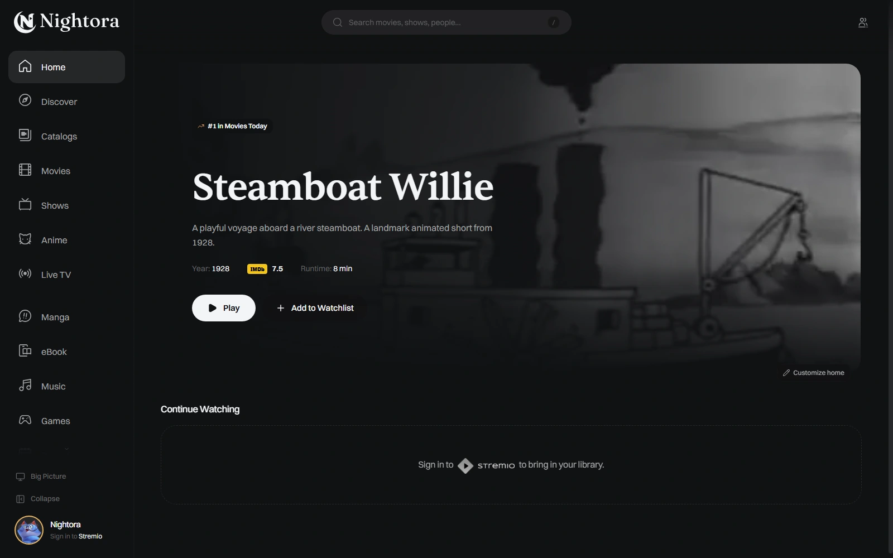
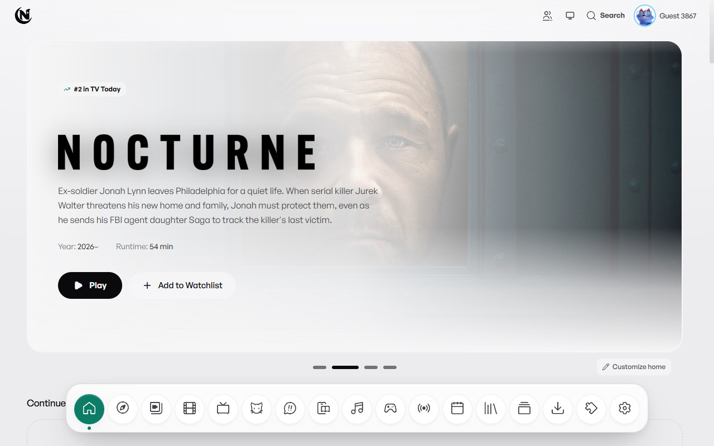

<picture>
  <source media="(prefers-color-scheme: dark)" srcset="docs/media/nightora-wordmark-dark.svg">
  
</picture>

### Your media, your way.

Movies, shows, anime, music and reading — together in a native desktop app.

[Website](https://nightora.vercel.app/) · [Features](#a-place-for-everything) · [Screenshots](#make-it-yours) · [Downloads](#get-nightora) · [Report an issue](https://github.com/RealChroma/Nightora-Releases/issues)

 

  

## A place for everything

<table>
<tr>
<td width="50%" valign="top">

### Discover your next watch

Browse movies, shows and anime. Explore seasons, cast, recommendations and reviews, then keep your favorites, lists and watch queue organized.

</td>
<td width="50%" valign="top">

### A player that feels at home

Native mpv playback, subtitles, picture-in-picture, customizable controls, keyboard shortcuts and an optional external mpv player.

</td>
</tr>
<tr>
<td width="50%" valign="top">

### Bring your sources

Connect Stremio addons, local files or your media server. Add Live TV playlists, a TorBox cloud library or an existing Nuvio account.

</td>
<td width="50%" valign="top">

### Keep your place

Connect your own Trakt, AniList, MyAnimeList, Simkl or PublicMetaDB account. Nightora accounts add username-based profiles, compatible sync and community features.

</td>
</tr>
<tr>
<td width="50%" valign="top">

### More than movies

Listen to music, pin playlists to Music home, read manga and ebooks, or connect a reading source. Different rooms keep each collection easy to find.

</td>
<td width="50%" valign="top">

### Settle in together

Watch Together rooms, friends, groups and notifications help you share an evening. Discord activity is optional, and profiles keep personal preferences separate.

</td>
</tr>
</table>

## Make it yours

Choose a theme, adjust the layout, tune your colors and fonts, and shape the player around the way you watch.

<table>
<tr>
<td width="50%" align="center">
 
<b>Classic</b> · A focused sidebar and full-width featured media.
</td>
<td width="50%" align="center">
 
<b>Minimal</b> · A light palette and compact bottom navigation.
</td>
</tr>
</table>

Demo profiles shown.

## Get Nightora

Nightora is currently in a small Windows friends preview. Public installers will appear on the [releases page](https://github.com/RealChroma/Nightora-Releases/releases) when available.

The setup wizard includes Nightora's white and gold artwork. Updates use Nightora's own update signatures. macOS, Linux and Meta Quest builds are planned.

Visit [nightora.vercel.app](https://nightora.vercel.app/) for current availability and setup information.

## Help improve Nightora

Found a problem? [Open an issue](https://github.com/RealChroma/Nightora-Releases/issues) with your Nightora version, operating system and the steps to reproduce it. Keep passwords, access tokens, recovery keys and private media links out of reports.

Nightora plays media from the files, servers and services you choose. It does not host media or bundle content addons. Use sources you are authorized to access. Nightora is not affiliated with Stremio Ltd.

---

Made with care by <a href="https://github.com/RealChroma">RealChroma</a> · <a href="https://nightora.vercel.app/contributors">Credits</a> · <a href="https://nightora.vercel.app/legal">Licenses</a>

